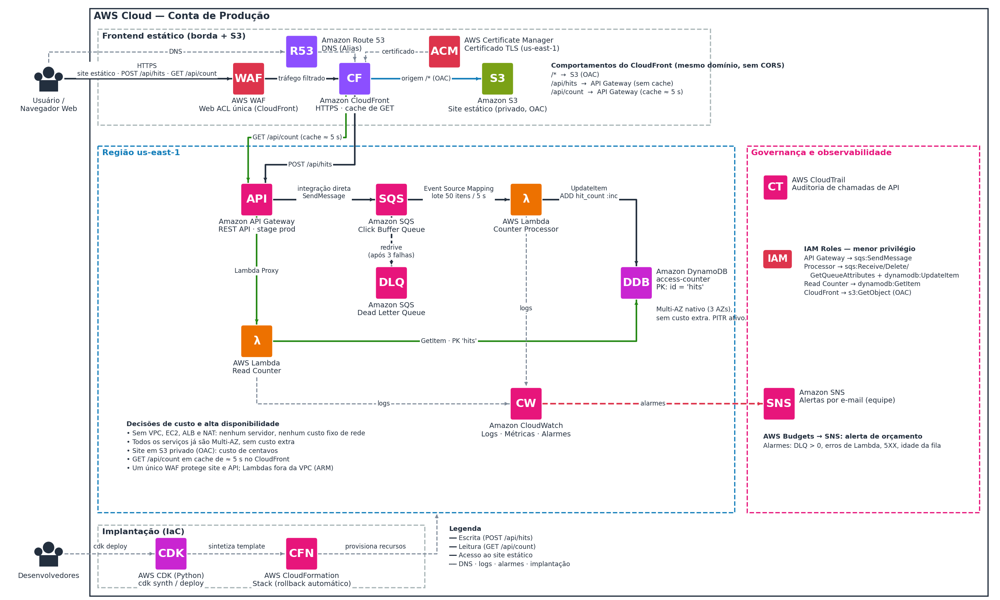
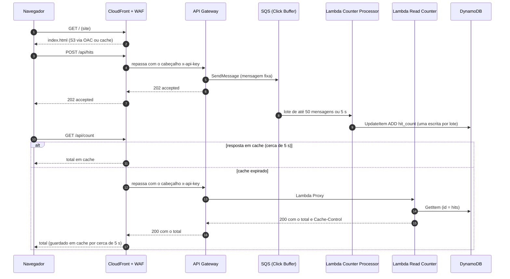

<p align="center">
  
</p>

<h1 align="center">FORGE</h1>

<p align="center">
  <b>Ferramenta de Observabilidade e Registro para Geração de Estatísticas</b><br>
  Contador de interessados para uma página "Em Breve", 100% serverless na AWS.
</p>

<p align="center">
  
  
  
  
  
</p>

> **Em uma frase:** o visitante clica em "Tenho interesse", o clique entra em uma fila, uma função soma os cliques em lote e grava o total no banco de dados, e a página consulta esse total para mostrar na tela.

Trabalho de Conclusão de Curso da **Escola da Nuvem**, desenvolvido por **Eduardo, Guilherme, Jair, João Paulo e Vanessa**.

**Quer implantar?** Vá direto para a [seção 12, Implantação passo a passo](#12-implantação-passo-a-passo).

---

## Sumário

1. [Sobre o projeto](#1-sobre-o-projeto)
2. [O desafio](#2-o-desafio)
3. [Arquitetura](#3-arquitetura)
4. [Como funciona](#4-como-funciona)
5. [Serviços AWS e por que foram escolhidos](#5-serviços-aws-e-por-que-foram-escolhidos)
6. [Decisões de projeto](#6-decisões-de-projeto)
7. [Segurança](#7-segurança)
8. [Observabilidade e alertas](#8-observabilidade-e-alertas)
9. [Alta disponibilidade](#9-alta-disponibilidade)
10. [Custos](#10-custos)
11. [O template CloudFormation](#11-o-template-cloudformation)
12. [Implantação passo a passo](#12-implantação-passo-a-passo)
13. [Operação e manutenção](#13-operação-e-manutenção)
14. [Limitações e pontos de atenção](#14-limitações-e-pontos-de-atenção)
15. [Roteiro e status](#15-roteiro-e-status)
16. [Estrutura do repositório](#16-estrutura-do-repositório)
17. [Perguntas frequentes](#17-perguntas-frequentes)
18. [Glossário](#18-glossário)
19. [Equipe](#19-equipe)

---

## 1. Sobre o projeto

Uma startup de marketing vai lançar um produto novo e criou uma página de "Em Breve". Ela quer mostrar quantas pessoas já demonstraram interesse, mas não sabe se vai receber 10 ou 1 milhão de acessos.

Por isso, a solução precisa ser:

- **Sem servidor para cuidar:** ninguém precisa atualizar, corrigir ou dimensionar máquinas.
- **Barata:** paga-se pelo uso, e quase nada quando ninguém acessa.
- **Elástica:** cresce sozinha quando o movimento aumenta e encolhe quando ele passa.

Este repositório reúne a arquitetura desenhada na AWS para resolver esse problema, a justificativa de cada escolha, as estimativas de custo feitas na AWS Pricing Calculator e o template do AWS CloudFormation que cria toda a infraestrutura.

## 2. O desafio

O case pedia uma solução com três peças principais:

| Peça | Papel no case |
|---|---|
| **Amazon API Gateway** | A porta de entrada que recebe o clique do usuário |
| **AWS Lambda** | O código que roda só quando é chamado e soma o clique no banco |
| **Amazon DynamoDB** | O banco de dados que guarda o total de acessos |

E três pontos de atenção:

- **Permissões (IAM):** por padrão, nada na AWS conversa com nada. Cada serviço só pode fazer o que foi explicitamente autorizado.
- **Partition Key:** no DynamoDB usamos uma chave fixa (`id = "hits"`), já que existe um único contador.
- **Infraestrutura como código:** todo o ambiente é descrito em um template do AWS CloudFormation (YAML).

Partimos desse núcleo e evoluímos o desenho em algumas versões até chegar à arquitetura final. As principais mudanças foram adicionar uma fila entre a API e o banco (para aguentar picos), colocar o CloudFront na frente de tudo (um único ponto de entrada) e trocar o servidor do site por um site estático no S3.

## 3. Arquitetura



*Seta preta: escrita. Verde: leitura. Azul: acesso ao site estático. Tracejada: DNS, logs, alarmes e implantação.*

A arquitetura se divide em quatro blocos:

| Bloco | Componentes |
|---|---|
| **Frontend estático (borda + S3)** | Route 53, ACM, WAF, CloudFront e um bucket S3 privado com os arquivos do site |
| **Backend serverless (us-east-1)** | API Gateway REST, fila SQS (e fila de falhas), duas funções Lambda e a tabela DynamoDB. Nada disso usa VPC |
| **Governança e observabilidade** | CloudWatch (logs, métricas e alarmes), SNS (avisos por e-mail), CloudTrail (auditoria), IAM (permissões) e AWS Budgets (alerta de custo) |
| **Implantação (IaC)** | Template do CloudFormation que cria toda a infraestrutura de uma vez, com rollback automático em caso de erro |

O diagrama editável está em [`docs/arquitetura-final.drawio`](docs/arquitetura-final.drawio) (abre no [draw.io](https://app.diagrams.net)).

> **Sobre o WAF no desenho:** ele aparece "na frente" do CloudFront só para facilitar a leitura. Na prática, é uma Web ACL associada à distribuição do CloudFront e vale para todas as requisições, tanto do site quanto da API.

> **Sobre o bloco de implantação no desenho:** o diagrama mostra o AWS CDK gerando o template. A infraestrutura deste repositório está escrita diretamente em CloudFormation (YAML) e é implantada com a AWS CLI, então a etapa de síntese do CDK não existe aqui. O template também cria recursos de apoio que não aparecem no desenho: o segredo no AWS Secrets Manager (chave de origem da API), a função que publica a página de demonstração e o bucket que guarda os logs do CloudTrail.

### Comportamentos do CloudFront (mesmo domínio, sem CORS)

| Caminho | Origem | Cache |
|---|---|---|
| `/*` | Amazon S3 privado, acessado por OAC | Política gerenciada *CachingOptimized* |
| `/api/hits` | API Gateway (stage `prod`) | Nunca (política gerenciada *CachingDisabled*) |
| `/api/count` | API Gateway (stage `prod`) | Cerca de 5 s (parâmetro `CountCacheTtlSeconds`) |

## 4. Como funciona

O S3 só guarda e entrega os arquivos do site. Quem leva a informação até o banco é o JavaScript que roda no navegador, chamando a API **no mesmo domínio**. Por isso o API Gateway não se conecta ao S3.



**Passo a passo:**

1. O navegador abre o site. O DNS (Route 53) aponta para o CloudFront, que entrega o `index.html` a partir do S3 (ou do cache).
2. O JavaScript da página chama a API no mesmo domínio: `POST /api/hits` quando a pessoa clica e `GET /api/count` para mostrar o total. Como a origem é a mesma, não existe problema de CORS.
3. A chamada passa pelo WAF e o CloudFront a encaminha ao API Gateway com o cabeçalho `x-api-key`, uma chave secreta que só o CloudFront conhece.
4. No **POST**, o API Gateway converte o pedido em uma mensagem e a entrega direto na fila SQS, sem passar por Lambda. O corpo enviado pelo navegador é ignorado: a mensagem gravada é sempre a mesma.
5. A Lambda **Counter Processor** lê a fila em lotes (até 50 mensagens ou 5 segundos), conta o lote e faz **uma única** atualização atômica no DynamoDB.
6. No **GET**, o API Gateway chama a Lambda **Read Counter**, que lê o item `hits` no DynamoDB e devolve o total com o cabeçalho `Cache-Control: public, max-age=5`. O CloudFront guarda essa resposta por cerca de 5 segundos.
7. Se o processamento de um lote falhar, as mensagens voltam para a fila. Depois de 3 tentativas, vão para a fila de falhas (DLQ) e um alarme avisa a equipe por e-mail.

Exemplo de como a página chama a API:

```javascript
// Registrar um clique de interesse (mesmo domínio, sem CORS)
await fetch("/api/hits", { method: "POST" });

// Ler o total acumulado (cache de cerca de 5 s no CloudFront)
const resposta = await fetch("/api/count");
const { count } = await resposta.json();
```

**Respostas da API:**

| Chamada | Sucesso | Falha |
|---|---|---|
| `POST /api/hits` | `202` `{"status":"accepted"}` | `502` `{"message":"nao foi possivel registrar"}` |
| `GET /api/count` | `200` `{"count": N}` | `500` `{"message":"indisponivel"}` (sem cache) |
| Qualquer rota chamada direto no endereço do API Gateway, sem a chave | — | `403` |

**Quanto tempo leva para o total refletir um clique?** Cerca de 10 a 15 segundos (janela do lote de até 5 s, mais o processamento, mais o cache de 5 s). Para dar a sensação de resposta imediata, a página de demonstração soma o clique localmente na tela assim que a API responde.

## 5. Serviços AWS e por que foram escolhidos

| Serviço | O que faz aqui | Por que escolhemos |
|---|---|---|
| **Amazon Route 53** | DNS: registros Alias (A e AAAA) do domínio para o CloudFront | Endereço próprio, integrado à conta AWS e usado também na validação do certificado |
| **AWS Certificate Manager (ACM)** | Certificado HTTPS do domínio, validado por DNS | Renovação automática. Para o CloudFront, precisa estar em `us-east-1` |
| **AWS WAF** | Firewall na borda: limite de requisições por IP em `/api/*` e regras gerenciadas da AWS | O endpoint de escrita é público. Sem proteção, qualquer script poderia inflar o contador e a conta |
| **Amazon CloudFront** | Ponto único de entrada: site e API, HTTPS, cabeçalhos de segurança e cache | Um só WAF, um só certificado, um só domínio (sem CORS) e cache da leitura |
| **Amazon S3** | Guarda os arquivos do site (bucket privado, acesso só pelo CloudFront via OAC) | Site estático não precisa de servidor. Durável e sem manutenção |
| **Amazon API Gateway (REST)** | Recebe `POST /api/hits` e `GET /api/count` | Fala direto com o SQS (sem código na escrita), controla taxa de requisições e exige a chave de API |
| **AWS Secrets Manager** | Gera e guarda a chave compartilhada entre CloudFront e API Gateway | A chave não aparece em parâmetros nem no Git |
| **Amazon SQS, Click Buffer** | Fila que guarda os cliques até serem processados | Amortece os picos: quem envia e quem processa trabalham em ritmos diferentes |
| **Amazon SQS, DLQ** | Fila das mensagens que falharam 3 vezes | Nenhum clique se perde em silêncio e nada fica travado |
| **AWS Lambda, Counter Processor** | Lê a fila em lotes, conta e grava no DynamoDB | Executa só quando há trabalho. Roda em ARM (Graviton), fora da VPC |
| **AWS Lambda, Read Counter** | Responde o total com `GetItem` | Separada da escrita: permissão mínima, escala e falhas independentes |
| **Amazon DynamoDB** | Guarda o total em um único item (`id = "hits"`, atributo `hit_count`) | Serverless e com incremento atômico, sem risco de dois acessos simultâneos se atropelarem |
| **Amazon CloudWatch** | Logs, métricas e alarmes | Falha silenciosa é pior que falha avisada |
| **Amazon SNS + AWS Budgets** | Avisos por e-mail (alarmes e orçamento) | Transformam alarme em mensagem que alguém lê |
| **AWS CloudTrail** | Registro de quem criou, alterou ou apagou recursos | Auditoria é requisito básico em produção |
| **AWS IAM** | Permissões de cada componente | Cada peça só faz o estritamente necessário |
| **AWS CloudFormation** | Cria, atualiza e remove toda a infraestrutura a partir do template | Reproduzível, revisável e reversível (rollback automático) |

## 6. Decisões de projeto

**Por que serverless?**
Porque não sabemos o volume. Sem servidores, não há máquina para dimensionar, atualizar ou deixar ligada sem uso, e o custo acompanha o tráfego.

**Por que uma fila (SQS) entre a API e o banco?**
Em um pico, milhares de cliques chegam ao mesmo tempo. A fila guarda esses cliques de forma durável (até 14 dias) e a Lambda os processa no ritmo dela, em lotes. Isso protege o banco, limita as execuções simultâneas (no máximo 5 por padrão) e garante que nenhum clique se perde se algo falhar no meio do caminho.

**Por que o CloudFront na frente de tudo?**
Com um único ponto de entrada, um só WAF protege site e API, existe um só certificado e um só domínio (sem CORS), e o total fica em cache na borda.

**Por que o navegador não grava direto no DynamoDB?**
Exigiria credenciais no cliente, sem WAF, sem controle de taxa e sem a fila que absorve picos. A API intermediária é mais segura e mais simples de operar.

**Por que o site é estático (S3) e não um servidor (EC2)?**
O site só precisa mostrar a página e chamar a API. Um servidor traria custo fixo, manutenção e a necessidade de replicar em mais de uma zona. Se um dia o site precisar de lógica própria, o CloudFront já consegue rotear um novo caminho para outra origem sem refazer o contador.

**Por que sem VPC?**
Nenhum dos serviços usados precisa de rede privada. Sem VPC, não há NAT Gateway nem sub-redes para administrar.

**Por que DynamoDB e não um banco relacional?**
O contador só precisa de um incremento atômico. O DynamoDB é serverless, distribui os dados entre zonas e dispensa conexões e instâncias.

**Por que API Gateway REST e não HTTP API?**
A REST oferece integração direta com o SQS, chave de API, plano de uso e controle de taxa. A HTTP API cobra menos por requisição e fica como otimização futura, caso o volume cresça, desde que se resolva a perda da chave de API.

**Por que duas Lambdas em vez de uma?**
Leitura e escrita têm permissões, ritmos e falhas diferentes. Separadas, cada uma recebe só a permissão de que precisa (`UpdateItem` ou `GetItem`).

### Como chegamos aqui

O desenho passou por quatro versões até a arquitetura final:

| Aspecto | Arq. 1 (EC2 único) | Arq. 2 (borda estática) | Arq. 3 (EC2 Multi-AZ) | **Arquitetura final** |
|---|---|---|---|---|
| Site | EC2 em 1 zona | S3 + CloudFront | EC2 em 2 zonas + ALB | **S3 + CloudFront** |
| Servidores | 1 EC2 | Nenhum | 2 EC2 (Auto Scaling) | **Nenhum** |
| WAF | 1 ACL | 2 ACLs | 1 ACL | **1 ACL** |
| API | Direto | Direto (com CORS) | Atrás do CloudFront | **Atrás do CloudFront, sem CORS** |
| Cache de leitura | Nenhum | No API Gateway (pago à parte) | CloudFront | **CloudFront** |
| Se uma zona cair | Site fora do ar | Sem impacto | Sem impacto | **Sem impacto** |

A arquitetura final mantém o que funcionava na Arquitetura 2 (site estático, sem servidores) e incorpora três melhorias: CloudFront na frente da API, um único WAF e o cache da leitura na borda.

## 7. Segurança

A segurança foi pensada em camadas:

- **Site:** bucket S3 privado, com *Block Public Access*, *BucketOwnerEnforced*, criptografia SSE-S3 e versionamento. Só o CloudFront lê o bucket, via OAC, e a política vale apenas para esta distribuição. HTTP é redirecionado para HTTPS.
- **Cabeçalhos de segurança:** HSTS (1 ano), `X-Content-Type-Options`, `X-Frame-Options: DENY`, `Referrer-Policy: strict-origin-when-cross-origin` e uma *Content Security Policy* restrita ao próprio domínio.
- **Borda:** WAF com limite de 500 requisições por IP a cada 5 minutos em `/api/*` e o conjunto de regras gerenciadas *AWSManagedRulesCommonRuleSet*, aplicados a site e API. Começa em modo *Count* para ajustar falsos positivos antes de bloquear. Conexões ao CloudFront exigem TLS 1.2 ou superior.
- **API:** toda rota exige a chave de API, que só o CloudFront envia. Uma chamada direta ao endereço do API Gateway, ignorando o CloudFront, recebe `403`. Há também *throttling* de 50 requisições por segundo (rajada de 100) no stage e no plano de uso.
- **Mensagem fixa na fila:** o corpo enviado pelo navegador é ignorado. O API Gateway grava sempre a mesma mensagem no SQS, então o cliente não consegue injetar conteúdo.
- **Dados:** criptografia em repouso no SQS; DynamoDB com PITR (restauração dos últimos 35 dias), proteção contra exclusão em `prod` e retenção da tabela mesmo se a stack for apagada.
- **Transporte:** filas, buckets e tópico SNS recusam chamadas sem TLS (`aws:SecureTransport`).
- **Auditoria e alertas:** trilha do CloudTrail em todas as regiões, com validação de integridade dos arquivos de log, e alarmes que avisam por e-mail via SNS (seção 8).

**Permissões (menor privilégio), exatamente como estão no template:**

| Quem | Pode | Em |
|---|---|---|
| API Gateway | `sqs:SendMessage` | Fila Click Buffer |
| API Gateway | `lambda:InvokeFunction` (só `GET /api/count`) | Lambda Read Counter |
| Counter Processor | `sqs:ReceiveMessage`, `sqs:DeleteMessage`, `sqs:GetQueueAttributes`, `dynamodb:UpdateItem`, escrever no próprio log group | Fila Click Buffer e tabela do contador |
| Read Counter | `dynamodb:GetItem`, escrever no próprio log group | Tabela do contador |
| Site Publisher | `s3:PutObject`, `cloudfront:CreateInvalidation`, escrever no próprio log group | Bucket do site e distribuição |
| CloudFront (via OAC) | `s3:GetObject` e `s3:ListBucket`, só para a própria distribuição | Bucket do site |
| CloudWatch Alarms e AWS Budgets | `sns:Publish`, só da própria conta | Tópico de alertas |
| CloudTrail | `s3:GetBucketAcl` e `s3:PutObject` | Bucket da trilha |

## 8. Observabilidade e alertas

O template cria seis alarmes no CloudWatch. Todos avisam o tópico SNS quando disparam e quando voltam ao normal:

| Alarme | O que observa | Dispara quando |
|---|---|---|
| `dlq-not-empty` | Mensagens visíveis na DLQ | Houver qualquer mensagem (> 0) em 1 minuto |
| `queue-oldest-message-age` | Idade da mensagem mais antiga na fila principal | Passar de 10 minutos (processamento travado) |
| `counter-processor-errors` | Erros da Lambda Counter Processor | Houver qualquer erro em 5 minutos |
| `read-counter-errors` | Erros da Lambda Read Counter | Houver qualquer erro em 5 minutos |
| `api-5xx` | Respostas 5XX do API Gateway | Houver qualquer 5XX em 5 minutos |
| `cloudfront-5xx-rate` | Taxa de erros 5xx do CloudFront | Ficar acima de 5% por 10 minutos |

Além disso:

- **AWS Budgets:** orçamento mensal (US$ 20 por padrão) com aviso por e-mail e SNS quando o gasto real passa de 80% e quando o previsto passa de 100%. O orçamento cobre a conta inteira.
- **Logs:** cada Lambda tem seu log group com retenção de 14 dias. Os logs de acesso do API Gateway são opcionais (`EnableApiAccessLogs`).
- **Métricas:** o stage do API Gateway e as duas regras do WAF publicam métricas no CloudWatch.

## 9. Alta disponibilidade

Como não há servidor nem balanceador para replicar, a alta disponibilidade já vem embutida: S3, CloudFront, API Gateway, SQS, Lambda (fora da VPC) e DynamoDB distribuem dados e execução por várias zonas de disponibilidade, sem configuração adicional.

| Falha | Efeito no site | Efeito no contador |
|---|---|---|
| Uma zona de disponibilidade | Nenhum | Nenhum |
| O backend serverless | Site segue no ar; o botão mostra uma mensagem de erro | Mensagens já na fila ficam retidas por até 14 dias |
| A região `us-east-1` | Arquivos já em cache continuam sendo servidos pela borda | Indisponível até a região voltar; dados preservados |

A região única é uma aceitação consciente: para um contador de interesse, a queda de uma região inteira é rara e o custo de se proteger disso (multirregião) supera o benefício.

## 10. Custos

Todos os valores desta seção vêm das **seis estimativas da AWS Pricing Calculator** feitas para o projeto (região US East, N. Virginia), exportadas em 08/10/2026 (cenário de 1 milhão) e 09/10/2026 (demais cenários). Os PDFs estão em [`docs/custos/`](docs/custos) e cada estimativa pode ser aberta na calculadora pelo link da tabela.

### Resumo por cenário

| Cenário (acessos/mês) | Custo mensal (USD) | Custo em 12 meses (USD) | Custo mensal (BRL) | Custo em 12 meses (BRL) | Estimativa |
|---|---:|---:|---:|---:|---|
| 1 mil | US$ 8,64 | US$ 103,68 | R$ 43,36 | R$ 520,34 | [PDF](docs/custos/estimativa-1-mil.pdf) · [calculadora](https://calculator.aws/#/estimate?id=86071ed7c56bbe2527cc1b8ce267e8d5610467b1) |
| 10 mil | US$ 8,82 | US$ 105,84 | R$ 44,26 | R$ 531,18 | [PDF](docs/custos/estimativa-10-mil.pdf) · [calculadora](https://calculator.aws/#/estimate?id=acc98fe7b0c65dabb38814482be3603aa26543c2) |
| 50 mil | US$ 9,63 | US$ 115,56 | R$ 48,33 | R$ 579,96 | [PDF](docs/custos/estimativa-50-mil.pdf) · [calculadora](https://calculator.aws/#/estimate?id=f9fa69da6d8a16a2c56bbb88ae88a62930e734a5) |
| 100 mil | US$ 10,62 | US$ 127,44 | R$ 53,30 | R$ 639,58 | [PDF](docs/custos/estimativa-100-mil.pdf) · [calculadora](https://calculator.aws/#/estimate?id=34072166d60f35b17d04d8d796401b4e0eef95cb) |
| 500 mil | US$ 186,72 | US$ 2.240,64 | R$ 937,09 | R$ 11.245,10 | [PDF](docs/custos/estimativa-500-mil.pdf) · [calculadora](https://calculator.aws/#/estimate?id=f6bedc05fc75d16e108447178f77fab2a8ede659) |
| **1 milhão (caso principal)** | **US$ 451,87** | **US$ 5.422,44** | **R$ 2.267,80** | **R$ 27.213,60** | [PDF](docs/custos/estimativa-1-milhao.pdf) · [calculadora](https://calculator.aws/#/estimate?id=bab27f6ebc5c56a0644e5dd4a729f208384dd352) |

Custo inicial (upfront) de US$ 0,00 em todos os cenários. Conversão para reais pelo câmbio de referência adotado pela equipe: USD 1 = BRL 5,0187.

### Custo mensal por serviço (USD)

| Serviço | 1 mil | 10 mil | 50 mil | 100 mil | 500 mil | 1 milhão |
|---|---:|---:|---:|---:|---:|---:|
| Amazon CloudFront | 0,03 | 0,11 | 0,47 | 0,92 | 172,48 | 431,98 |
| AWS WAF | 7,01 | 7,05 | 7,27 | 7,54 | 9,70 | 12,40 |
| Amazon API Gateway | 0,00 | 0,04 | 0,17 | 0,35 | 1,75 | 3,50 |
| Amazon S3 | 0,00 | 0,00 | 0,01 | 0,02 | 0,08 | 0,16 |
| Amazon SQS | 0,00 | 0,01 | 0,06 | 0,12 | 0,60 | 1,20 |
| AWS Lambda (duas linhas na estimativa) | 0,00 | 0,00 | 0,00 | 0,00 | 0,00 | 0,00 |
| Amazon DynamoDB | 0,20 | 0,21 | 0,23 | 0,21 | 0,51 | 0,83 |
| Amazon Route 53 | 0,50 | 0,50 | 0,52 | 0,56 | 0,70 | 0,90 |
| Amazon CloudWatch | 0,90 | 0,90 | 0,90 | 0,90 | 0,90 | 0,90 |
| Amazon SNS | 0,00 | 0,00 | 0,00 | 0,00 | 0,00 | 0,00 |
| AWS CloudTrail | 0,00 | 0,00 | 0,00 | 0,00 | 0,00 | 0,00 |
| **Total mensal** | **8,64** | **8,82** | **9,63** | **10,62** | **186,72** | **451,87** |

### Volumes usados em cada estimativa

| Item configurado na calculadora | 1 mil | 10 mil | 50 mil | 100 mil | 500 mil | 1 milhão |
|---|---:|---:|---:|---:|---:|---:|
| CloudFront: requisições HTTPS/mês | 9.000 | 90.000 | 450.000 | 900.000 | 4,5 milhões | 9 milhões |
| CloudFront: saída para a internet | 0 GB | 0 GB | 0 GB | 0 GB | 1.976 GB | 4.976 GB |
| CloudFront: saída para a origem | 1 GB | 1 GB | 1 GB | 1 GB | 1 GB | 1 GB |
| API Gateway: requisições/mês | 1.000 | 10.000 | 50 mil | 100.000 | 500 mil | 1 milhão |
| SQS: requisições de fila padrão/mês | 3 mil | 30 mil | 150 mil | 300 mil | 1,5 milhão | 3 milhões |
| Lambda: requisições/mês (primeira linha) | 200 | 2.000 | 10.000 | 20.000 | 100.000 | 200.000 |
| Lambda: requisições/mês (segunda linha) | 100 | 100 | 100 | 100 | 100 | 100 |
| S3: solicitações GET/mês | 400 | 4.000 | 20.000 | 40.000 | não detalhado no PDF | 400.000 |

Configuração igual em todos os cenários: WAF com 1 Web ACL e 2 regras; Route 53 com 1 zona hospedada; CloudWatch com 1 GB de logs, 1 painel e 4 alarmes; CloudTrail com 1 trilha de eventos de gerenciamento; Lambda calculada em arquitetura x86 com 512 MB de armazenamento temporário. Nos cenários em que o PDF detalha esses serviços (o de 500 mil não detalha S3, DynamoDB e SNS): DynamoDB classe Standard com 1 GB de PITR e SNS com 1.000 solicitações e 1.000 notificações por e-mail.

### O que os números mostram

- **Até 100 mil acessos, o custo é quase todo fixo.** O WAF (Web ACL + 2 regras) responde por 71% a 81% do total, e a conta fica entre US$ 8,64 e US$ 10,62 por mês.
- **De 500 mil em diante, o CloudFront domina.** Ele representa 92,4% do total em 500 mil e 95,6% em 1 milhão, puxado pela transferência de dados para a internet configurada nesses cenários (1.976 GB e 4.976 GB).
- **O backend quase não pesa.** API Gateway, SQS, Lambda e DynamoDB somam US$ 5,53 no cenário de 1 milhão.

### Diferenças entre as estimativas e o template

As estimativas foram feitas sobre o desenho da arquitetura. Ao comparar com o template, estes pontos ficam fora da calculadora ou configurados de outro jeito:

| Ponto | Na calculadora | No template |
|---|---|---|
| Arquitetura das Lambdas | x86 | `arm64` (Graviton) |
| Alarmes do CloudWatch | 4 | 6 |
| AWS Secrets Manager | Não incluído | 1 segredo (chave de origem da API) |
| Bucket S3 dos logs do CloudTrail | Não incluído | Criado quando `EnableCloudTrail=true` |
| Lambda Site Publisher | Não incluída | Executa só no deploy, quando `PublishPlaceholderSite=true` |
| ACM e AWS Budgets | Não incluídos | Criados pelo template |
| Registro do domínio | Não incluído | Fora do template (pré-requisito) |

### Controle de custo

- O orçamento padrão do template é de **US$ 20/mês** (`MonthlyBudgetUsd`). Ele cobre os cenários até 100 mil acessos, mas fica abaixo dos cenários de 500 mil (US$ 186,72) e 1 milhão (US$ 451,87). Ajuste o valor ao cenário esperado.
- O template registra que os planos de preço fixo do CloudFront não estão modelados. Se forem adotados, será preciso ajustar a política de cache do total e a Web ACL, porque esses planos não aceitam políticas de cache próprias nem grupos de regras gerenciadas no WAF.

> A calculadora fornece apenas uma estimativa. O custo real depende do uso de cada serviço.

## 11. O template CloudFormation

Toda a infraestrutura está em um único arquivo: [`infra/contador-acessos-site-estatico.yaml`](infra/contador-acessos-site-estatico.yaml). Ele só pode ser implantado em `us-east-1`: a Web ACL do WAF com escopo CloudFront e o certificado do CloudFront só existem nessa região, e a regra `RegionMustBeUsEast1` do próprio template impede o deploy em outra.

### O que o template cria

Os nomes abaixo usam os valores padrão `ProjectName=access-counter` e `Environment=prod`.

| Seção | Recursos | Detalhes |
|---|---|---|
| **1. Dados** | Tabela DynamoDB `access-counter-prod-access-counter` | Sob demanda, chave `id` (texto), PITR, proteção contra exclusão em `prod`, mantida se a stack for apagada |
| **2. Filas** | `access-counter-prod-click-buffer` e `access-counter-prod-click-dlq` | Retenção de 14 dias e criptografia SSE-SQS nas duas. Na fila principal, redrive para a DLQ após 3 tentativas e visibility timeout de 190 s |
| **3. Lambdas** | `access-counter-prod-counter-processor` e `access-counter-prod-read-counter` | Python 3.12, arm64, 128 MB, fora da VPC, log groups com 14 dias de retenção. Lotes de 50 mensagens ou 5 s, com `ReportBatchItemFailures` e concorrência máxima de 5 |
| **4. API** | REST API `access-counter-prod-api`, stage `prod`, chave de API, plano de uso e segredo `access-counter/prod/origin-verify-key` | `POST /api/hits` com integração direta ao SQS e `GET /api/count` com Lambda Proxy. Toda rota exige a chave |
| **5. Site** | Bucket `access-counter-prod-site-<conta>-us-east-1` | Privado, criptografado, versionado (versões antigas expiram em 30 dias), mantido se a stack for apagada |
| **6. Borda** | Certificado ACM, Web ACL, OAC, política de cache do total, política de cabeçalhos de segurança, distribuição CloudFront e registros A e AAAA no Route 53 | HTTP/2 e HTTP/3, IPv6, `PriceClass_100`, TLS mínimo 1.2 |
| **7. Página de demonstração** | Lambda `access-counter-prod-site-publisher` e um recurso customizado | Grava uma página "Em Breve" funcional no bucket e invalida o cache. Opcional |
| **8. Observabilidade e custo** | Tópico SNS `access-counter-prod-alerts`, assinatura de e-mail, seis alarmes e orçamento `access-counter-prod-monthly-cost` | Ver seção 8 |
| **9. Auditoria** | Trilha `access-counter-prod-trail` e bucket da trilha | Multirregião, validação de integridade, logs mantidos por 365 dias. Opcional |

### Parâmetros

| Parâmetro | Padrão | Para que serve |
|---|---|---|
| `DomainName` | **obrigatório** | Domínio público do site e da API, em minúsculas (ex.: `contador.exemplo.com.br`) |
| `HostedZoneId` | **obrigatório** | ID da zona hospedada pública do domínio no Route 53 |
| `AlertEmail` | **obrigatório** | E-mail que recebe os alarmes e os alertas de orçamento |
| `ProjectName` | `access-counter` | Prefixo dos nomes de todos os recursos (4 a 24 caracteres: minúsculas, números e hífen) |
| `Environment` | `prod` | `prod`, `staging` ou `dev`. Em `prod`, a tabela fica com proteção contra exclusão |
| `MonthlyBudgetUsd` | `20` | Limite mensal do AWS Budgets, em USD |
| `WafEnforcementMode` | `Count` | `Count` só registra; `Block` bloqueia de fato |
| `ApiRateLimitPer5Min` | `500` | Requisições a `/api/*` permitidas por IP a cada 5 minutos |
| `ApiThrottleRate` | `50` | Requisições por segundo no API Gateway (limite global) |
| `ApiThrottleBurst` | `100` | Rajada máxima no API Gateway |
| `ApiStageName` | `prod` | Nome do stage, usado como caminho de origem no CloudFront |
| `OriginVerifySecretVersionId` | vazio | Versão do segredo da chave de origem. Usado na rotação da chave |
| `EnableApiAccessLogs` | `false` | Liga os logs de acesso do API Gateway (exige o papel de logs do API Gateway já configurado na conta) |
| `CountCacheTtlSeconds` | `5` | Tempo de cache do `GET /api/count`, de 1 a 60 s |
| `CloudFrontPriceClass` | `PriceClass_100` | `PriceClass_100` não inclui a América do Sul; `PriceClass_All` inclui, com custo maior |
| `PublishPlaceholderSite` | `true` | Publica a página "Em Breve" de demonstração |
| `SiteVersion` | `1` | Altere para republicar a página de demonstração |
| `ProcessorMaxConcurrency` | `5` | Concorrência máxima do Counter Processor (2 a 1.000) |
| `ProcessorTimeoutSeconds` | `30` | Timeout do Counter Processor (3 a 300 s) |
| `QueueVisibilityTimeoutSeconds` | `190` | Visibility timeout da fila: no mínimo 6 vezes o timeout da Lambda mais 5 s |
| `LogRetentionDays` | `14` | Retenção dos log groups |
| `EnableCloudTrail` | `true` | Cria a trilha. Use `false` se a conta já tiver uma trilha organizacional |
| `TrailLogRetentionDays` | `365` | Retenção dos logs do CloudTrail no S3 (mínimo 90) |

### Saídas (Outputs)

| Saída | O que é |
|---|---|
| `SiteUrl` | URL pública do site e da API |
| `DistributionId` | ID da distribuição CloudFront (usado em invalidações) |
| `DistributionDomainName` | Domínio padrão do CloudFront (também protegido pelo WAF) |
| `SiteBucketName` | Bucket privado do site |
| `WebAclArn` | ARN da Web ACL |
| `ApiId` | ID da REST API |
| `ApiDirectUrl` | Endereço direto do API Gateway, só para o teste de contorno (deve responder `403`) |
| `ValidationCommands` | Comandos `curl` do teste de contorno |
| `ClickQueueUrl` | URL da fila Click Buffer |
| `ClickDeadLetterQueueUrl` | URL da DLQ |
| `CounterTableName` | Nome da tabela do contador |
| `AlertTopicArn` | ARN do tópico de alertas |
| `OriginVerifySecretArn` | ARN do segredo com a chave de origem |

## 12. Implantação passo a passo

> **Status:** o template ainda não foi implantado nem testado em uma conta real. Valide primeiro em uma conta ou ambiente de teste.

### 12.1 Pré-requisitos

| O que | Para quê |
|---|---|
| Conta AWS com permissão para criar todos os recursos do template, inclusive IAM roles | O deploy usa `CAPABILITY_IAM` |
| [AWS CLI v2](https://docs.aws.amazon.com/cli/latest/userguide/getting-started-install.html) configurada (`aws configure` ou SSO) | Executar os comandos abaixo |
| Um domínio com **zona hospedada pública** no Route 53 | Validação do certificado e registros do site |
| Um e-mail para alertas | Alarmes e orçamento |
| Opcional: [cfn-lint](https://github.com/aws-cloudformation/cfn-lint) (`pip install cfn-lint`) | Validar o template localmente |

### 12.2 Clonar o repositório

```bash
git clone https://github.com/E-A-D-S/FORGE-CONTADOR-DE-ACESSOS.git
cd FORGE-CONTADOR-DE-ACESSOS
```

### 12.3 Definir as variáveis da implantação

```bash
export AWS_REGION=us-east-1
export STACK=access-counter-prod
export DOMINIO=contador.exemplo.com.br        # seu domínio
export EMAIL=equipe@exemplo.com.br            # e-mail dos alertas
export CONTA=$(aws sts get-caller-identity --query Account --output text)

# ID da zona hospedada (use só o trecho depois de /hostedzone/)
aws route53 list-hosted-zones-by-name --dns-name exemplo.com.br \
  --query "HostedZones[0].Id" --output text
export ZONA=Z0123456789ABC                    # cole aqui o ID retornado
```

### 12.4 Criar o bucket de artefatos

O template tem cerca de 53 KB, acima do limite de 51.200 bytes que a AWS CLI aceita para enviar um template diretamente. Por isso, ele precisa passar por um bucket S3 na validação e no deploy:

```bash
export ARTEFATOS=access-counter-cfn-$CONTA
aws s3 mb s3://$ARTEFATOS --region $AWS_REGION
```

### 12.5 Validar o template

```bash
# Validação local
cfn-lint infra/contador-acessos-site-estatico.yaml

# Validação pela AWS
aws s3 cp infra/contador-acessos-site-estatico.yaml s3://$ARTEFATOS/contador-acessos-site-estatico.yaml
aws cloudformation validate-template \
  --template-url https://$ARTEFATOS.s3.amazonaws.com/contador-acessos-site-estatico.yaml
```

### 12.6 Implantar a stack

```bash
aws cloudformation deploy --region $AWS_REGION \
  --stack-name $STACK \
  --template-file infra/contador-acessos-site-estatico.yaml \
  --s3-bucket $ARTEFATOS \
  --capabilities CAPABILITY_IAM \
  --parameter-overrides DomainName=$DOMINIO HostedZoneId=$ZONA \
                        AlertEmail=$EMAIL Environment=prod \
  --tags Project=access-counter Environment=prod Owner=equipe CostCenter=marketing
```

As tags da stack se propagam para todos os recursos que as suportam. O comando só termina quando a stack fica pronta, o que pode levar vários minutos, principalmente por causa da validação do certificado e da criação da distribuição do CloudFront. Para acompanhar em outro terminal:

```bash
aws cloudformation describe-stack-events --stack-name $STACK --region $AWS_REGION \
  --max-items 15 --query "StackEvents[].[ResourceStatus,LogicalResourceId,ResourceStatusReason]" --output table
```

Se algo falhar, o CloudFormation desfaz tudo automaticamente. Na primeira criação, a stack fica em `ROLLBACK_COMPLETE` e precisa ser apagada antes de uma nova tentativa. Recursos marcados para serem mantidos (tabela e buckets) podem permanecer na conta e, como os nomes são fixos, devem ser removidos antes de tentar de novo.

### 12.7 Consultar as saídas

```bash
aws cloudformation describe-stacks --stack-name $STACK --region $AWS_REGION \
  --query "Stacks[0].Outputs" --output table
```

### 12.8 Confirmar o e-mail de alertas

O SNS envia um e-mail de confirmação para `AlertEmail`. **Clique no link de confirmação:** sem isso, nenhum alarme chega a ninguém.

### 12.9 Testar o funcionamento

```bash
# 1. O site abre por HTTPS (página "Em Breve" de demonstração)
curl -I https://$DOMINIO

# 2. Registrar um clique pelo domínio (passa pelo CloudFront e pelo WAF)
curl -i -X POST https://$DOMINIO/api/hits
# esperado: HTTP 202 e {"status":"accepted"}

# 3. Ler o total (aguarde de 10 a 15 s depois do clique)
curl -s https://$DOMINIO/api/count
# esperado: {"count": N}, com N aumentando a cada clique registrado

# 4. Teste de contorno: chamar o API Gateway direto, sem passar pelo CloudFront
API_DIRETA=$(aws cloudformation describe-stacks --stack-name $STACK --region $AWS_REGION \
  --query "Stacks[0].Outputs[?OutputKey=='ApiDirectUrl'].OutputValue" --output text)
curl -i -X POST $API_DIRETA
# esperado: HTTP 403

# 5. Conferir o valor gravado no DynamoDB
aws dynamodb get-item --region $AWS_REGION \
  --table-name access-counter-prod-access-counter \
  --key '{"id":{"S":"hits"}}'
```

Abra também `https://<seu domínio>` no navegador, clique em **Tenho interesse** e veja o total aumentar.

### 12.10 Ativar o bloqueio no WAF

O WAF começa em modo `Count`, que só registra. Depois de alguns dias, revise as requisições de amostra da Web ACL no console do WAF (regras `RateLimitApiPerIp` e `AWSManagedRulesCommonRuleSet`). Sem falsos positivos, ative o bloqueio:

```bash
aws cloudformation deploy --region $AWS_REGION \
  --stack-name $STACK \
  --template-file infra/contador-acessos-site-estatico.yaml \
  --s3-bucket $ARTEFATOS \
  --capabilities CAPABILITY_IAM \
  --parameter-overrides DomainName=$DOMINIO HostedZoneId=$ZONA \
                        AlertEmail=$EMAIL Environment=prod WafEnforcementMode=Block
```

### 12.11 Publicar o site real

O recurso `SitePublisher` grava apenas a página "Em Breve" de demonstração. Para publicar o site definitivo a partir de uma pasta `site/`:

```bash
BUCKET=$(aws cloudformation describe-stacks --stack-name $STACK --region $AWS_REGION \
  --query "Stacks[0].Outputs[?OutputKey=='SiteBucketName'].OutputValue" --output text)
DIST=$(aws cloudformation describe-stacks --stack-name $STACK --region $AWS_REGION \
  --query "Stacks[0].Outputs[?OutputKey=='DistributionId'].OutputValue" --output text)

aws s3 sync ./site s3://$BUCKET --delete
aws cloudfront create-invalidation --distribution-id $DIST --paths "/index.html"
```

Depois, atualize a stack com `PublishPlaceholderSite=false` para que a página de demonstração não seja mais gerenciada pelo template. Se o site real carregar recursos de outros domínios, ajuste a *Content Security Policy* em `SecurityHeadersPolicy`.

### 12.12 Ajustar o orçamento

O orçamento padrão é de US$ 20/mês. Se o tráfego esperado for de 500 mil ou 1 milhão de acessos, ajuste `MonthlyBudgetUsd` de acordo com a [seção 10](#10-custos).

### Checklist de conclusão

- [ ] Stack em `CREATE_COMPLETE`
- [ ] E-mail de alertas confirmado
- [ ] Site abre por HTTPS no domínio
- [ ] `POST /api/hits` responde `202`
- [ ] `GET /api/count` mostra o total aumentando
- [ ] Chamada direta ao API Gateway responde `403`
- [ ] WAF em modo `Block` depois da revisão
- [ ] Orçamento ajustado ao tráfego esperado

## 13. Operação e manutenção

**Revisar mudanças antes de aplicar.** Gere o conjunto de alterações sem executá-lo e confira o que vai mudar:

```bash
aws cloudformation deploy --region $AWS_REGION --stack-name $STACK \
  --template-file infra/contador-acessos-site-estatico.yaml --s3-bucket $ARTEFATOS \
  --capabilities CAPABILITY_IAM --no-execute-changeset \
  --parameter-overrides DomainName=$DOMINIO HostedZoneId=$ZONA AlertEmail=$EMAIL Environment=prod
```

**Alterar rotas ou métodos da API.** O CloudFormation não reimplanta o stage sozinho quando os métodos mudam. Ao alterar recursos ou métodos da API, renomeie o logical ID `ApiDeployment` (por exemplo, `ApiDeploymentR2`) e ajuste `ApiStage.DeploymentId` para o novo nome.

**Rotacionar a chave de origem.** Gere um novo valor no Secrets Manager e informe o novo `VersionId` na stack. A chave de API e o cabeçalho do CloudFront mudam juntos, mas pode haver uma janela curta de `403` até o CloudFront propagar a mudança:

```bash
aws secretsmanager put-secret-value --region $AWS_REGION \
  --secret-id access-counter/prod/origin-verify-key \
  --secret-string "$(aws secretsmanager get-random-password --password-length 40 \
                      --exclude-punctuation --query RandomPassword --output text)"
# anote o VersionId retornado e atualize a stack com OriginVerifySecretVersionId=<VersionId>
```

**Acompanhar os logs das Lambdas:**

```bash
aws logs tail /aws/lambda/access-counter-prod-counter-processor --follow --region $AWS_REGION
aws logs tail /aws/lambda/access-counter-prod-read-counter --follow --region $AWS_REGION
```

**Tratar mensagens na DLQ.** Quando o alarme `dlq-not-empty` disparar, corrija a causa (os logs do Counter Processor mostram o erro) e devolva as mensagens para a fila principal:

```bash
DLQ_ARN=$(aws sqs get-queue-attributes --region $AWS_REGION \
  --queue-url $(aws sqs get-queue-url --queue-name access-counter-prod-click-dlq --region $AWS_REGION --query QueueUrl --output text) \
  --attribute-names QueueArn --query Attributes.QueueArn --output text)
aws sqs start-message-move-task --source-arn $DLQ_ARN --region $AWS_REGION
```

**Remover o ambiente.**

```bash
aws cloudformation delete-stack --stack-name $STACK --region $AWS_REGION
aws cloudformation wait stack-delete-complete --stack-name $STACK --region $AWS_REGION
```

A tabela do DynamoDB, o bucket do site e o bucket da trilha são **mantidos** de propósito. Para apagá-los, desative a proteção contra exclusão da tabela (`aws dynamodb update-table --table-name access-counter-prod-access-counter --no-deletion-protection-enabled`), esvazie os buckets (incluindo as versões antigas) e remova-os manualmente.

## 14. Limitações e pontos de atenção

Preferimos deixar claro o que a solução **não** faz:

| Ponto | O que fazemos a respeito |
|---|---|
| **O endpoint de escrita é público.** Qualquer script pode chamar `POST /api/hits` | Limite de taxa por IP no WAF, *throttling* e chave de API. O contador mede interesse, não visitantes únicos |
| **Contorno do CloudFront** | Chave de API enviada só pelo CloudFront, teste de chamada direta (deve responder `403`) e rotação periódica da chave |
| **O total tem atraso** de 10 a 15 s | Documentado. A página soma o clique localmente na tela |
| **Duplicidade rara:** a fila entrega "ao menos uma vez" e a retentativa de um lote pode contar de novo até 50 cliques | Aceitável para um contador de interesse. Para contagem exata, usaríamos fila FIFO ou um registro de idempotência |
| **Região única** | Aceito. Os dados ficam preservados se a região cair |
| **`PriceClass_100` não inclui pontos de presença na América do Sul** | Visitantes do Brasil são atendidos por pontos de outras regiões. `PriceClass_All` inclui a América do Sul, com custo maior |
| **Deploy manual** até o pipeline entrar | Revisar o conjunto de alterações (`--no-execute-changeset`) antes de cada mudança e revisão por outra pessoa |
| **Alterações na API exigem renomear `ApiDeployment`** | Documentado na seção 13 |
| **IPs em logs** do WAF e do CloudFront, se ativados | Retenção curta e finalidade definida, pensando na LGPD |
| **O site não tem lógica de servidor** | Qualquer dinamismo vai para a API |
| **Template ainda não testado em conta real** | Validar com `cfn-lint` e implantar primeiro em ambiente de teste |

## 15. Roteiro e status

| Fase | Entregas | Pronto quando | Situação |
|---|---|---|---|
| **0. Fundação** | Conta de produção, MFA, domínio no Route 53, repositório Git, Budgets e SNS | Template validado e alerta de orçamento ativo | Budgets e SNS no template; conta, MFA e domínio são configurados à parte |
| **1. Backend núcleo** | DynamoDB, SQS e DLQ, Lambdas, API Gateway com chave de API e throttling | O POST incrementa e o GET devolve o total | Descrito no template |
| **2. Observabilidade** | Retenção de logs, alarmes, SNS confirmado, CloudTrail | Revogar uma permissão gera DLQ, alarme e e-mail em minutos | Descrito no template |
| **3. Borda e site** | S3 privado com o site, ACM, CloudFront com WAF (modo Count), Route 53, `/api` atrás do CloudFront | O domínio abre por HTTPS, o botão grava, o total aparece e a chamada direta à API é rejeitada | Descrito no template |
| **4. CI/CD** | Pipeline com testes e aprovação manual, branch protegida | Um push na `main` só chega à produção com aprovação | Planejada |
| **5. Endurecimento e go-live** | Teste de carga, revisão do IAM, runbook da DLQ, WAF em modo bloqueio, escolha do plano do CloudFront | Uma semana sem alarmes inesperados e custo dentro do previsto | Planejada |

**Status atual:** arquitetura definida e documentada, custos estimados na AWS Pricing Calculator e template CloudFormation escrito. O template ainda não foi implantado nem testado em conta real.

## 16. Estrutura do repositório

```text
FORGE-CONTADOR-DE-ACESSOS/
├── README.md                                   # este arquivo
├── .gitignore
├── infra/
│   └── contador-acessos-site-estatico.yaml     # template CloudFormation com toda a infraestrutura
└── docs/
    ├── arquitetura-final.drawio                # diagrama editável (draw.io)
    ├── custos/                                 # estimativas da AWS Pricing Calculator
    │   ├── estimativa-1-mil.pdf
    │   ├── estimativa-10-mil.pdf
    │   ├── estimativa-50-mil.pdf
    │   ├── estimativa-100-mil.pdf
    │   ├── estimativa-500-mil.pdf
    │   └── estimativa-1-milhao.pdf
    └── img/
        ├── arquitetura-final.png               # imagem do diagrama usada neste README
        └── forge-banner.jpg                    # identidade visual do projeto
```

## 17. Perguntas frequentes

**O API Gateway se conecta ao S3?**
Não. O S3 só serve os arquivos do site. O API Gateway se conecta ao SQS (escrita) e à Lambda (leitura). A ponte entre o site e a API é o JavaScript do navegador, que chama `/api` no mesmo domínio.

**Como o clique chega até o DynamoDB?**
Navegador, CloudFront (com WAF), API Gateway, SQS, Lambda Counter Processor e, por fim, o DynamoDB. O S3 não participa desse caminho.

**Como impedir que alguém chame o API Gateway direto, ignorando o WAF?**
Toda rota exige uma chave de API que só o CloudFront envia, no cabeçalho `x-api-key`. A chave é gerada pelo Secrets Manager e não fica no código. Sem ela, a resposta é `403`.

**O que acontece se a API cair?**
O site continua no ar (S3 + CloudFront). A página mostra uma mensagem de erro sem quebrar. As mensagens que já estavam na fila ficam retidas por até 14 dias e são processadas quando tudo voltar.

**O contador pode ser inflado por robôs?**
Em parte. O limite de requisições por IP no WAF, o *throttling* e o plano de uso reduzem o estrago, mas o contador mede interesse, não pessoas únicas. Existe um serviço de controle de bots no WAF, mas ele é contratado à parte.

**Por que usar fila e lote se o volume é baixo?**
Com pouco tráfego, o ganho do lote é pequeno. Mesmo assim, a fila garante que nenhum clique se perde se o banco ou a Lambda falharem, e o ganho aparece nos picos.

**E se o contador contar duas vezes?**
A fila padrão entrega "ao menos uma vez", então duplicatas raras são possíveis e aceitáveis para este caso. Se precisássemos de exatidão, usaríamos fila FIFO com deduplicação.

**Por que `us-east-1` se o público é brasileiro?**
A Web ACL do WAF com escopo CloudFront e o certificado do CloudFront só existem em `us-east-1`. Além disso, o site e o total são servidos pelo cache da borda; só o `POST` e as leituras fora do cache viajam até a região.

**Quanto custa e o que mais pesa?**
Segundo as estimativas da calculadora, de US$ 8,64 a US$ 10,62 por mês até 100 mil acessos, com o WAF como maior item. Em 500 mil e 1 milhão de acessos, US$ 186,72 e US$ 451,87, com o CloudFront respondendo por mais de 90% do total. Detalhes na [seção 10](#10-custos).

**Como atualizamos o site?**
Com `aws s3 sync` para o bucket do site e uma invalidação do CloudFront (seção 12.11). O bucket tem versionamento, então dá para voltar a uma versão anterior.

**Dá para migrar para um site dinâmico depois?**
Dá, sem refazer o backend: basta adicionar uma nova origem ao CloudFront, roteada por caminho (por exemplo, `/store/*`).

## 18. Glossário

| Termo | Significado |
|---|---|
| **Serverless** | Você não administra servidores. A AWS cuida de máquinas, atualizações e escala |
| **OAC** | *Origin Access Control*: permite que somente o CloudFront leia um bucket S3 privado |
| **Behavior (CloudFront)** | Regra que liga um caminho (por exemplo `/api/count`) a uma origem e a uma política de cache |
| **TTL / cache hit** | Tempo de vida de um item em cache. *Hit* é a resposta servida do cache, sem chamar a origem |
| **Price class** | Conjunto de pontos de presença do CloudFront que atendem a distribuição |
| **Web ACL** | Conjunto de regras do WAF associado a um recurso, aqui a distribuição do CloudFront |
| **Throttling / plano de uso** | Limite de requisições por segundo aplicado pelo API Gateway |
| **SQS / DLQ** | Fila de mensagens / fila para onde vão as mensagens que falham repetidamente |
| **Event Source Mapping** | Liga uma fonte (como o SQS) a uma Lambda, que passa a lê-la automaticamente |
| **ReportBatchItemFailures** | Permite à Lambda informar quais mensagens do lote falharam, para que voltem à fila |
| **Atômico** | Operação que acontece por inteiro ou não acontece, mesmo com várias chamadas simultâneas |
| **PITR** | *Point-in-Time Recovery*: restaura o DynamoDB a qualquer instante dos últimos 35 dias |
| **Multi-AZ** | Distribuição entre zonas de disponibilidade (datacenters isolados dentro de uma região) |
| **Consistência eventual** | O dado pode levar alguns instantes para refletir a última alteração |
| **IaC / CloudFormation** | Infraestrutura como código. O template descreve os recursos e o CloudFormation os cria, atualiza e remove |
| **Stack** | O conjunto de recursos criado a partir de um template |
| **Recurso customizado** | Recurso do CloudFormation executado por uma Lambda própria, aqui usado para publicar a página de demonstração |
| **Menor privilégio** | Cada componente recebe somente as permissões de que precisa |
| **Well-Architected** | Conjunto de boas práticas da AWS: segurança, confiabilidade, desempenho, custo, excelência operacional e sustentabilidade |

## 19. Equipe

Trabalho de Conclusão de Curso da **Escola da Nuvem**.

| Integrantes |
|---|
| Eduardo |
| Guilherme |
| Jair |
| João Paulo |
| Vanessa |

---

<p align="center"><b>FORGE</b> · Ferramenta de Observabilidade e Registro para Geração de Estatísticas</p>
